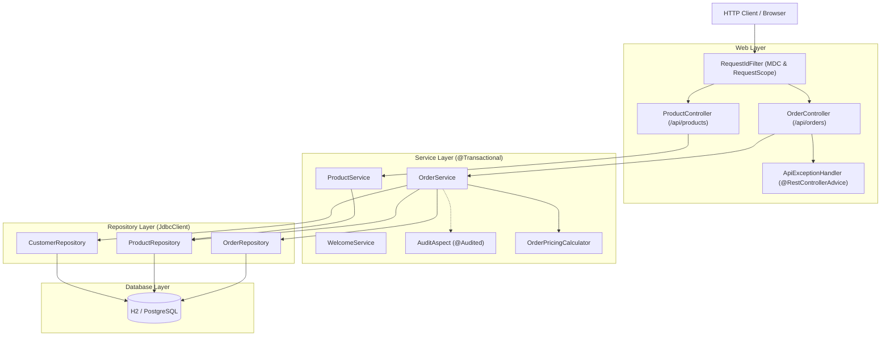
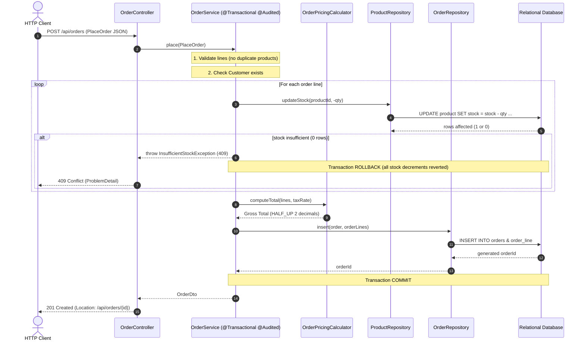

# Shop — Spring Boot Application

## 1. Maven Configuration (Task 1)

### Parent POM
The `spring-boot-starter-parent` in `pom.xml` provides default Maven configuration, recommended plugin settings, standard resource filtering, and dependency management for Spring Boot projects. This reduces boilerplate configuration.

### Dependency Version Management
Spring Boot manages compatible dependency versions through its parent POM (the BOM - Bill of Materials). Therefore, Spring Boot starters and managed dependencies do not need an explicit `<version>` tag in `pom.xml`. The parent POM supplies tested, compatible versions.

### Spring Boot Maven Plugin
The `spring-boot-maven-plugin` packages the application as an executable uber-JAR containing compiled application classes, all runtime dependencies, and the Spring Boot embedded loader. It also provides the `spring-boot:run` goal for development.

### Dependency Tree Excerpt
```bash
./mvnw dependency:tree | head -40
```
```text
[INFO] edu.itc.se:shop:jar:0.0.1-SNAPSHOT
[INFO] +- org.springframework.boot:spring-boot-starter-jdbc:jar:4.1.1:compile
[INFO] |  +- org.springframework.boot:spring-boot-starter:jar:4.1.1:compile
[INFO] |  |  +- org.springframework.boot:spring-boot-starter-logging:jar:4.1.1:compile
[INFO] |  |  |  +- ch.qos.logback:logback-classic:jar:1.5.38:compile
[INFO] |  |  |  |  \- ch.qos.logback:logback-core:jar:1.5.38:compile
[INFO] |  |  |  +- org.apache.logging.log4j:log4j-to-slf4j:jar:2.25.5:compile
[INFO] |  |  |  |  \- org.apache.logging.log4j:log4j-api:jar:2.25.5:compile
[INFO] |  |  |  \- org.slf4j:jul-to-slf4j:jar:2.0.18:compile
[INFO] |  |  +- jakarta.annotation:jakarta.annotation-api:jar:3.0.0:compile
[INFO] |  |  \- org.yaml:snakeyaml:jar:2.6:compile
[INFO] |  +- org.springframework.boot:spring-boot-jdbc:jar:4.1.1:compile
[INFO] |  |  +- org.springframework.boot:spring-boot-sql:jar:4.1.1:compile
[INFO] |  |  +- org.springframework.boot:spring-boot-transaction:jar:4.1.1:compile
[INFO] |  |  |  +- org.springframework.boot:spring-boot-persistence:jar:4.1.1:compile
[INFO] |  |  |  \- org.springframework:spring-tx:jar:7.0.9:compile
[INFO] |  |  \- org.springframework:spring-jdbc:jar:7.0.9:compile
[INFO] |  |     \- org.springframework:spring-beans:jar:7.0.9:compile
[INFO] |  \- com.zaxxer:HikariCP:jar:7.0.2:compile
[INFO] |     \- org.slf4j:slf4j-api:jar:2.0.18:compile
[INFO] +- org.springframework.boot:spring-boot-h2console:jar:4.1.1:compile
[INFO] |  \- org.springframework.boot:spring-boot:jar:4.1.1:compile
[INFO] |     +- org.springframework:spring-core:jar:7.0.9:compile
[INFO] |     |  \- commons-logging:commons-logging:jar:1.3.6:compile
[INFO] |     \- org.springframework:spring-context:jar:7.0.9:compile
[INFO] |        +- org.springframework:spring-aop:jar:7.0.9:compile
[INFO] |        \- org.springframework:spring-expression:jar:7.0.9:compile
[INFO] +- org.springframework.boot:spring-boot-starter-actuator:jar:4.1.1:compile
```

### Packaging & Executable JAR
```bash
./mvnw -q package
java -jar target/shop-0.0.1-SNAPSHOT.war --server.port=9090
```
- Endpoint check: `curl -i "http://localhost:9090/hello?name=Alice"`
- Executable archive size: `~35MB`. The size is due to packaging the embedded Tomcat web server, Jasper JSP compiler, Jackson JSON parser, HikariCP connection pool, and H2 database runtime into an executable archive.

### Condition Evaluation Report
When running with `--debug`, `DataSourceAutoConfiguration` matched because:
```text
DataSourceAutoConfiguration matched:
- @ConditionalOnClass found required classes 'javax.sql.DataSource',
  'org.springframework.jdbc.datasource.embedded.EmbeddedDatabaseType'
- @ConditionalOnMissingBean (types: javax.sql.DataSource,
  javax.sql.XADataSource; SearchStrategy: all) did not find any beans

DataSourceConfiguration.Hikari matched:
- @ConditionalOnClass found required class 'com.zaxxer.hikari.HikariDataSource'
- @ConditionalOnMissingBean (types: javax.sql.DataSource;
  SearchStrategy: all) did not find any beans
```

---

## 2. Inversion of Control & Dependency Injection (Task 2)

### Bean Wiring and Rules
- All dependencies use **constructor injection** with `final` fields.
- `Notifier` interface has three implementations:
  1. `EmailNotifier`: annotated with `@Primary`.
  2. `SmsNotifier`: qualified with `@Qualifier("smsNotifier")`.
  3. `ConsoleNotifier`: annotated with `@Profile("dev")` and `@Primary`.

### Two `@Primary` Beans Conflict Rule
If two beans of the same type are both annotated with `@Primary` and are active simultaneously in the ApplicationContext, Spring cannot resolve which candidate to inject and throws `NoUniqueBeanDefinitionException`.
To manage this:
- `@Profile("dev")` ensures `ConsoleNotifier` is only registered when the `dev` profile is active.
- When `dev` is active, it takes precedence in development; outside `dev`, `EmailNotifier` is the sole `@Primary`.
- `@Qualifier("smsNotifier")` explicitly selects `SmsNotifier` by name, bypassing primary resolution entirely.

### Scopes and Lifecycle
- `ReportBuilder` is prototype scoped (`@Scope("prototype")`). Calls to `reportBuilderProvider.getObject()` produce distinct instances with differing `System.identityHashCode`.
- Lifecycle callbacks (`@PostConstruct` and `@PreDestroy`) log initialization and teardown events.

---

## 3. JDBC, JdbcClient & Transactions (Task 3)

### Line-Count Comparison
- `RawJdbcProductRepository.findAll()`: ~15 lines (manual Connection, PreparedStatement, ResultSet looping, and SQLException handling).
- `ProductRepository.findAll()` (using `JdbcClient`): 4 lines.
- `JdbcClient` eliminates boilerplate, automates resource closing, maps rows to records, and converts SQL exceptions.

### Duplicate Key Translation
Inserting a product with an existing duplicate name throws `org.springframework.dao.DuplicateKeyException` (wrapping H2's `JdbcSQLIntegrityConstraintViolationException`).
The translation occurs inside Spring's `SQLExceptionTranslator` configured in `JdbcClient`/`JdbcTemplate`, which translates vendor-specific SQL error codes into Spring's unified `DataAccessException` hierarchy.

### Transaction Rollback
`ProductService.restock(fromId, toId, qty)` is annotated with `@Transactional`. If the source product lacks sufficient stock, or if the target product does not exist, an exception is thrown, rolling back all updates in the transaction and leaving stock balances unchanged.

---

## 4. REST API with Spring MVC, Validation & Error Handling (Task 4)

### Endpoints
Base URL: `/api/products`

| Method | Path | Description | Success Code | Error Codes |
|---|---|---|---|---|
| GET | `/api/products` | List all products (supports optional `?q=` name filter) | 200 OK | 500 |
| GET | `/api/products/{id}` | Get product details by ID | 200 OK | 404 |
| POST | `/api/products` | Create new product with validation | 201 Created (`Location` header) | 400, 409 |
| PATCH | `/api/products/{id}/stock` | Update product stock delta | 200 OK | 404, 409 |
| DELETE | `/api/products/{id}` | Delete product by ID | 204 No Content | 404 |

### Unified Error Handling (RFC 7807/9457 `ProblemDetail`)
`ApiExceptionHandler` (`@RestControllerAdvice`) handles all exceptions uniformly:
- `MethodArgumentNotValidException` -> 400 Bad Request with an array of field errors in the `errors` property.
- `ProductNotFoundException` -> 404 Not Found.
- `InsufficientStockException` -> 409 Conflict.
- `DuplicateKeyException` -> 409 Conflict.
- Generic `Exception` -> 500 Internal Server Error without leaking internal stack traces.

All curl transcript sessions are documented in [api-session.md](file:///Z:/Year%204/Software%20Engineering/Lab_02/api-session.md).

---

## 5. Views, Profiles, Actuator & Logging (Task 5)

### JSP Views
- `/products`: Server-rendered JSP table listing products, calculating gross prices (`price * (1 + taxRate)`), displaying active currency, and highlighting low-stock rows.
- `/products/new`: Add product form with server-side validation error rendering and POST-redirect-GET pattern.

### Profiles
- **`dev` profile**: H2 console enabled at `/h2-console`, DEBUG logging enabled for `edu.itc.se.shop` and SQL queries.
- **`prod` profile**: H2 console disabled, INFO logging level, datasource parameterized from environment variables `${DB_URL}`, `${DB_USER}`, `${DB_PASS}` targeting PostgreSQL.

### Actuator & Health Indicators
- Exposed endpoints: `health`, `info`, `metrics`, `loggers`.
- `LowStockHealthIndicator`: Reports `DOWN` status with `lowStockProducts` details when any product's stock is below `shop.low-stock-threshold`.

### MDC Logging & Timing Aspect
- `RequestIdFilter` generates an 8-character unique request ID stored in `MDC` and in a request-scoped `CurrentRequest` bean.
- `TimingAspect` intercepts service methods and logs execution times at DEBUG level.
- Log levels can be adjusted dynamically at runtime via Actuator:
  ```bash
  curl -X POST localhost:8080/actuator/loggers/edu.itc.se.shop.service.TimingAspect \
       -H 'Content-Type: application/json' -d '{"configuredLevel":"OFF"}'
  ```

---

## 6. Challenge: Layered Order Management

### Architecture & Component Diagram



### Request Flow: "Place Order"



### Transaction Boundary Analysis: Where and Why
The transaction boundary is demarcated using `@Transactional` at the **Service Layer** (`OrderService.place(..)` and `OrderService.cancel(..)`), rather than at the controller or repository layer:

1. **Why not at the Repository layer?**
   A repository method represents a single database operation (e.g., `updateStock` on one row or `insert` of an order header). In order placement, multiple distinct repository operations must occur together:
   - Decrementing stock for line 1
   - Decrementing stock for line 2
   - Inserting the order record
   - Inserting order lines
   If the transaction boundary were at the repository level, each SQL call would auto-commit individually. If line 2 failed due to insufficient stock, line 1's decrement would remain committed in the database, causing stock leakage.

2. **Why at the Service layer?**
   The Service layer embodies complete business use cases. Placing an order is an atomic business transaction: either all requested items are reserved and the order is persisted, or none are. By placing `@Transactional` on `OrderService.place(...)`, Spring opens a single JDBC connection with `autoCommit = false`. If an `InsufficientStockException` is thrown at any point during stock decrement or persistence, Spring's transaction manager intercepts the exception and issues a `ROLLBACK`, guaranteeing full atomicity (ACID).

3. **Why not at the Controller layer?**
   Controllers handle HTTP protocol concerns (headers, URI routing, JSON serialization, HTTP status code translation). Placing transactional boundaries on controllers leaks persistence lifecycle into the presentation layer, prevents services from being reused by asynchronous jobs or messaging listeners, and keeps database connections open during request parsing and response rendering.

---

## 7. PostgreSQL Configuration & Docker Compose

To run PostgreSQL in production:
```bash
docker compose up -d
```
Start the application with the `prod` profile:
```bash
./mvnw spring-boot:run -Dspring-boot.run.profiles=prod
```
The application will automatically connect to PostgreSQL on `localhost:5432` using credentials configured in `docker-compose.yml`.
